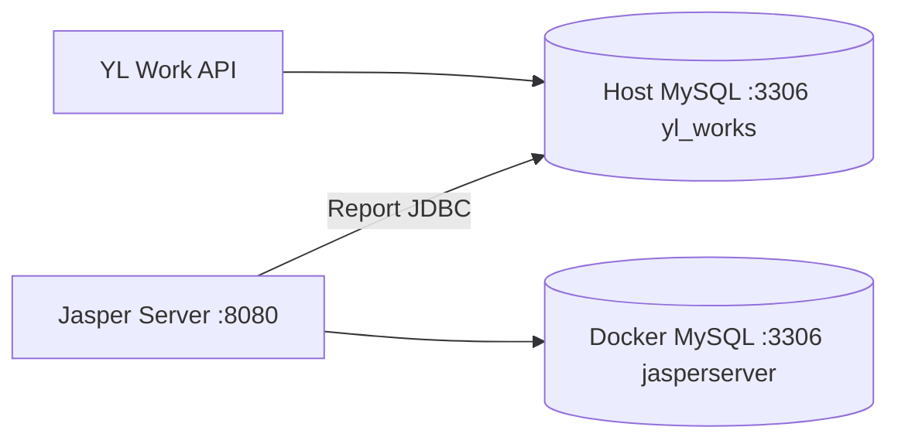

# JasperReports Server + YL Work

| Database | Where | Used for |
|----------|--------|----------|
| **yl_works** | Host MySQL `localhost:3306` | YL Work API (`appsettings.json` `DefaultConnection`) |
| **jasperserver** | Docker MySQL (`mysql` service, host port **3307**) | Jasper Server repository only |

You do **not** need to run any SQL on host MySQL for Jasper. Only ensure `yl_works` exists and migrations are applied.

## Architecture



## 1. YL Work database (host)

On your PC (already configured):

```json
"DefaultConnection": "server=localhost;port=3306;database=yl_works;user=YLworks;password=..."
```

Apply migrations from `backend/`:

```bash
dotnet ef database update
```

## 2. Start Jasper (Docker)

From `YLWorkLatest/`:

```bash
docker compose up -d
docker logs -f ylwork-jasperserver
```

- Jasper UI: **http://localhost:8080** (`jasperadmin` / `jasperadmin`). REST is at the same host (no `/jasperserver` prefix on this Docker image).
- Repo MySQL (optional DBeaver on PC): `127.0.0.1:3307`, user `root`, password `jasperdev`

First startup can take several minutes. Repo DB init runs from `docker/mysql-init/` on a **new** volume only.

## 3. JDBC data source for reports (yl_works on host)

Use **different host names** depending on where you test the connection:

| Tool | Runs on | JDBC host | Port |
|------|---------|-----------|------|
| **Jaspersoft Studio** | Your PC (Windows) | `127.0.0.1` or `localhost` | `3306` |
| **Jasper Server web UI** | Docker container | `host.docker.internal` | `3306` |

Do **not** use `host.docker.internal` in Jaspersoft Studio — it often causes **Connection timed out**.  
Do **not** use port `3307` for `yl_works` — that is the Docker Jasper **repo** MySQL, not YL Work.

### Jaspersoft Studio (design reports on your PC)

When creating a **Data Adapter** or testing JDBC in Studio:

| Field | Value |
|-------|--------|
| JDBC URL | `jdbc:mysql://127.0.0.1:3306/yl_works?useSSL=false&serverTimezone=UTC&allowPublicKeyRetrieval=true` |
| Driver | MySQL (`com.mysql.cj.jdbc.Driver`) |
| Username | `YLworks` |
| Password | Same as `DefaultConnection` in `appsettings.json` |

### Jasper Server UI (after publish)

**Manage** → **Data Sources** → **Add** → **JDBC**:

| Field | Value |
|-------|--------|
| JDBC URL | `jdbc:mysql://host.docker.internal:3306/yl_works?useSSL=false&serverTimezone=UTC&allowPublicKeyRetrieval=true` |
| Driver | MySQL (`com.mysql.cj.jdbc.Driver`) |
| Username | `YLworks` |
| Password | Same as `DefaultConnection` in `appsettings.json` |

If the test fails on the server, MySQL may only allow `YLworks@localhost`. On **host** MySQL run:

```sql
CREATE USER IF NOT EXISTS 'YLworks'@'%' IDENTIFIED BY 'YLSYSTEMS1';
GRANT ALL PRIVILEGES ON yl_works.* TO 'YLworks'@'%';
FLUSH PRIVILEGES;
```

(Adjust password to match your config.)

## 4. Publish reports & API

1. Design/publish `.jrxml` in Jaspersoft Studio; note repository path (e.g. `/reports/Invoice/MyReport`).
2. Assign the **yl_works** JDBC data source to the report.
3. Call YL Work API:

```http
POST /api/Report/download
Authorization: Bearer <jwt>
Content-Type: application/json

{
  "reportUri": "/reports/YourFolder/YourReport",
  "parameters": { "Id": "..." }
}
```

`JasperReports` in `backend/appsettings.json`:

```json
"JasperReports": {
  "BaseUrl": "http://localhost:8080",
  "Username": "jasperadmin",
  "Password": "jasperadmin"
}
```

## Troubleshooting

| Issue | Fix |
|-------|-----|
| Port 8080 in use | Change `8080:8080` in `docker-compose.yml` and update `JasperReports:BaseUrl` |
| Port 3307 in use | Change host mapping (e.g. `3308:3306`) or stop other Jasper demo stack |
| JDBC to yl_works fails | Use `host.docker.internal`; grant `YLworks@'%'` on host MySQL |
| Jasper won't start | `docker logs ylwork-jasper-mysql` and `docker logs ylwork-jasperserver` |
| Reset Jasper repo | `docker compose down -v` then `docker compose up -d` (wipes repo DB volume) |

## Files

| Path | Role |
|------|------|
| `docker-compose.yml` | `mysql` (repo) + `jasperserver` |
| `docker/mysql-init/01-jasperserver-repo.sql` | Creates `jasperserver` DB on first volume init |
| `backend/appsettings.json` | Host `yl_works` + `JasperReports` REST settings |
